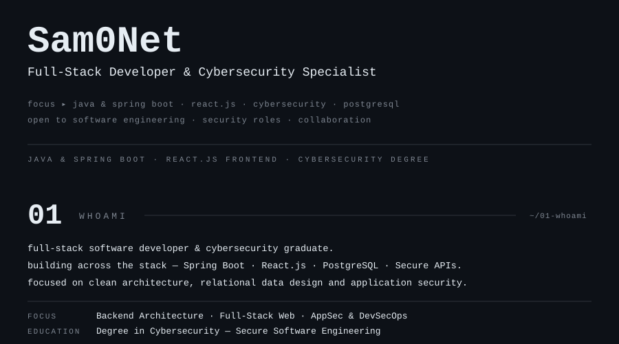
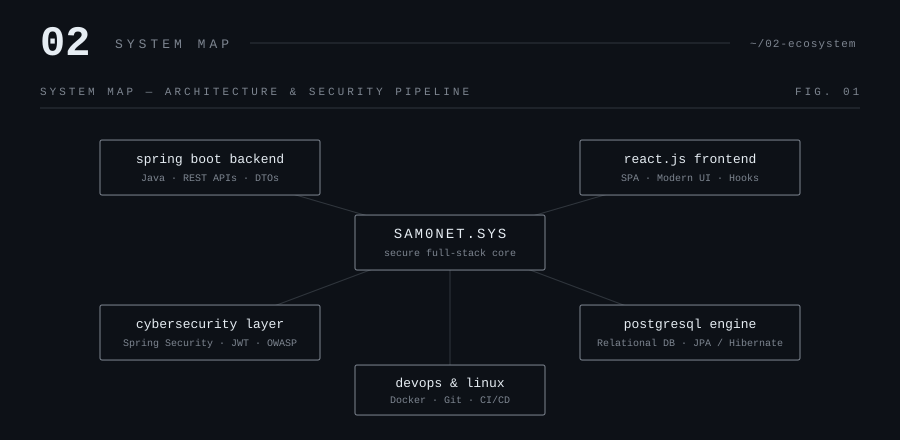
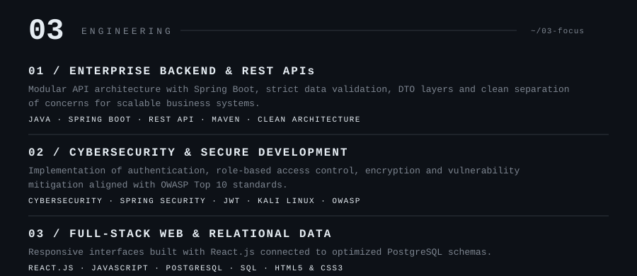
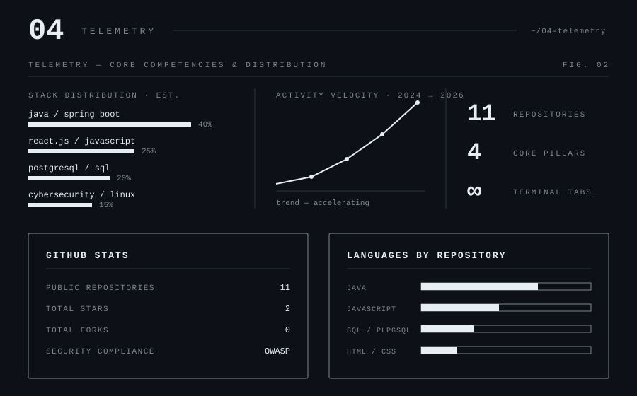
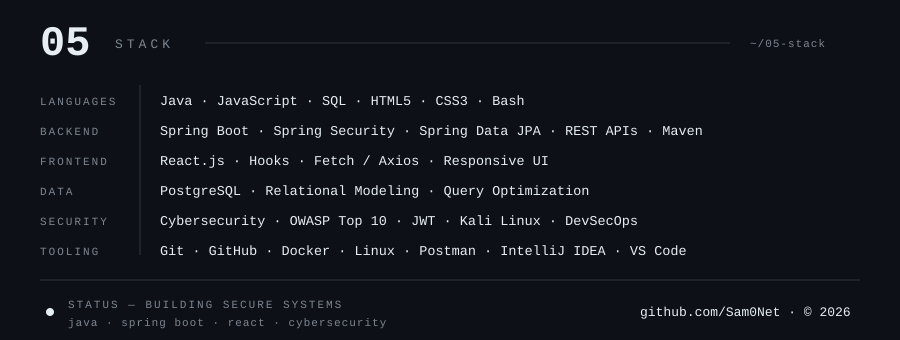

<!-- SNAKE AL INICIO -->

  <picture>
    <source media="(prefers-color-scheme: dark)" srcset="https://raw.githubusercontent.com/Sam0Net/Sam0Net/output/github-snake-dark.svg">
    <source media="(prefers-color-scheme: light)" srcset="https://raw.githubusercontent.com/Sam0Net/Sam0Net/output/github-snake.svg">
    
  </picture>

<!-- 01 WHOAMI -->

  

<!-- 02 SYSTEM MAP -->

  

<!-- 03 PROJECTS / ENGINEERING -->

  

<!-- 04 TELEMETRY + GITHUB STATS MONOCROMATICOS -->

  

  
  

<!-- 05 STACK -->

  

